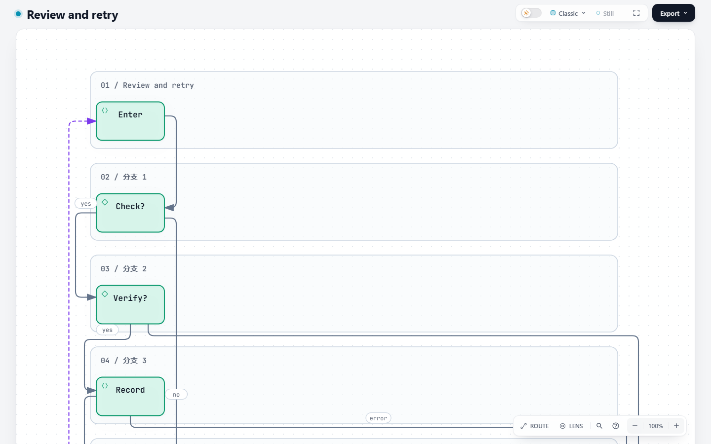
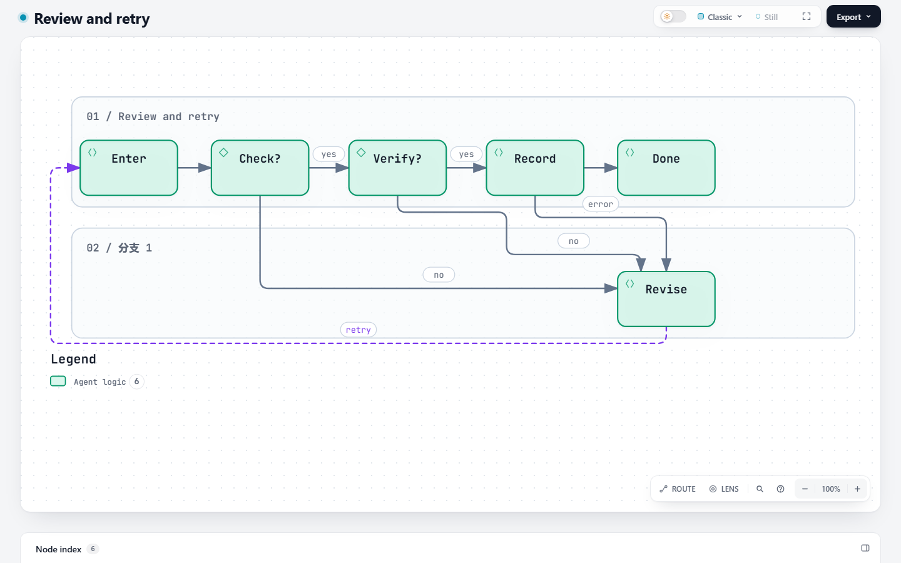
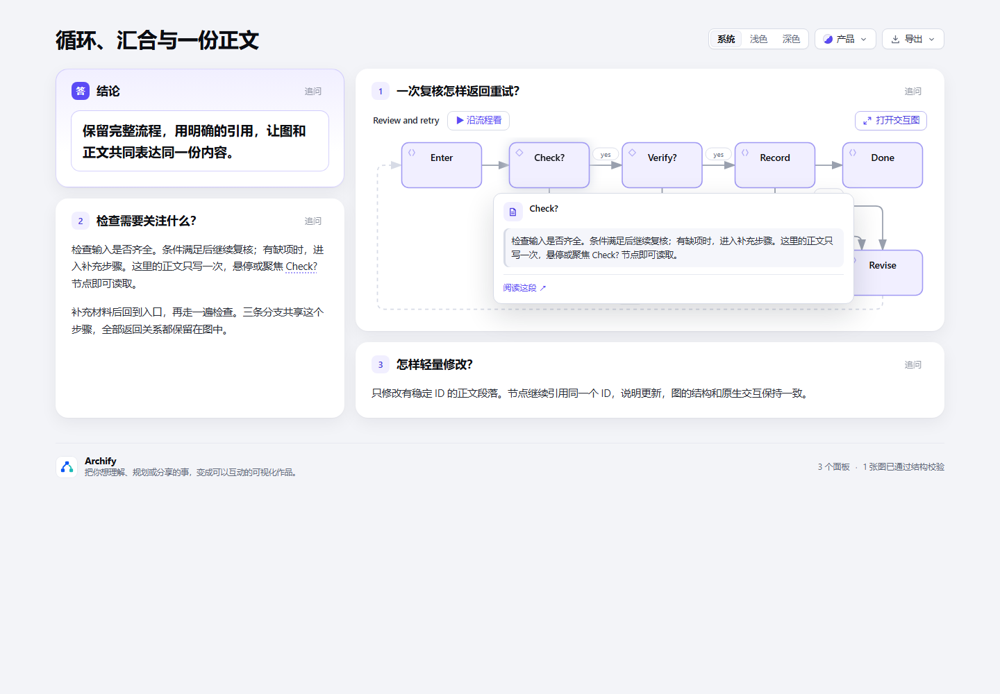

# Explainer cyclic layout and node explanations

Follow-up: [impact diagnosis and column-budget compatibility fix](impact-followup.md). The broad comparison below retains its original candidate SHA.

Base: `824db3ad62bae7f7acde02c65f3c236d41e60b5c` (dev). Candidate: `8bb803ef0c27a5602bf74330f16a78c66864749c`.

## Result and scope

A constructed compact workflow with six nodes, eight relationships, converging failure branches and a retry previously put every node in column zero. The placement pass now omits DFS back edges only while calculating ranks. The native graph still contains every authored node, relationship, direction, label and variant. Native layout, routing and the Viewer are unchanged. The same rank helper serves compact workflow and architecture declarations; authored native JSON geometry bypasses it.

This replay uses the base and candidate compact compilers with identical input and the same unchanged native renderer. It isolates the changed placement hints; it is not a fresh Agent generation comparison or a pair of complete independent package runs. [Before input](before.workflow.json), [after input](after.workflow.json), and [measurements](metrics.json) preserve the full topology.

| Before | After |
| --- | --- |
|  |  |

Both images use light / Classic / Still, 1440 × 900 CSS pixels, zoom 100%, scale 1 and the initial page state. The graph extends beyond the initial viewport on base; [before at 1440 × 1500](before-tall.png) and [after at 1440 × 1500](after-tall.png) provide a taller view under the same conditions.

Both screenshots are **standard-profile diagnostic views**. A separate showcase check reports two proper-crossing errors and one arrowhead collision on base, and no errors on candidate; required viewBox changes from 796 × 900 to 796 × 404. This is a result for this particular constructed input, not a claim that all cyclic layouts pass. The unchanged native validator remains authoritative for unsupported geometry.

## Reuse one explanation

The candidate-only [Markdown example](example.archify.md) binds a diagram node with `block:check-notes` to an explicitly identified prose block. Hover or keyboard focus displays its current body in the existing source card. The native Viewer still handles activation; updating the paragraph does not require duplicating its text into the diagram.



This example uses the product preset, light theme, 1440 × 1000 and a focused Check? node. Its native preview contains all six nodes; the smallest graph text is 13.75px against 14.5px body text. [Browser measurements](browser-evidence.json) record no console errors, horizontal overflow or interaction failures for this sample. Separate browser regressions cover keyboard activation, the accessibility description and a prose edit retaining the frozen native graph.

## Checks

All results below are Agent-run on Windows with Node 22.23.2 as the outer test runtime at the candidate SHA above. Some Bash-based packaging probes selected the system Node 24 and failed their canonical-toolchain requirement; those failures are retained. The actual submitted ZIP was separately rebuilt with canonical Node 22 and bundled zlib. Human confirmation is pending. [Structured results](checks.json) retain exact counts and failing test locations.

| Check | Result |
| --- | --- |
| Full Node regression | 3332 tests: 3027 passed, 61 failed, 53 cancelled, 191 skipped |
| Maintained Chrome inventory | 42 files; 298 passed, zero failed or skipped |
| Explainer on Edge | 8 passed, zero failed or skipped |
| Base replay of non-passing cases | 56 failures + 53 cancellations in filtered replay; remaining 5 failures recur in complete visual-check runs on both revisions |
| Generated freshness / golden renders | Passed |
| Isolated Explainer package smoke | Passed without dependencies |
| Canonical ZIP rebuild | Byte-identical SHA-256 |
| Constructed acyclic compatibility sample | 400 comparisons; zero differences |

Full regression is **not green**. Every candidate failure listed below was replayed on an untouched worktree of the base revision in the same environment. This preserves the distinction between base/environment failures and changed-code checks; it is not an exemption from required remote CI.

| File | Candidate outcome | Confirmed on base |
| --- | --- | --- |
| `test/browser-gate.test.mjs` | 3 failed | filtered failure replay |
| `test/ci-scope.test.mjs` | 2 failed | filtered failure replay |
| `test/cli.test.mjs` | 1 failed | filtered failure replay |
| `test/cloudflare-deployment-workflow.test.mjs` | 1 failed | filtered failure replay |
| `test/cursor-onboarding.test.mjs` | 1 failed | filtered failure replay |
| `test/delivery-contract.test.mjs` | 2 failed | filtered failure replay |
| `test/delivery-sidecar-path.test.mjs` | 1 failed | filtered failure replay |
| `test/explainer-diagrams.test.mjs` | 1 failed | filtered failure replay |
| `test/explainer-sources.test.mjs` | 1 failed | filtered failure replay |
| `test/meta-output-contract.test.mjs` | 2 failed | filtered failure replay |
| `test/ordinary-model-floor.test.mjs` | 1 failed | filtered failure replay |
| `test/output-path.test.mjs` | 11 failed | filtered failure replay |
| `test/preview.test.mjs` | 1 failed | filtered failure replay |
| `test/release-package-gates.test.mjs` | 6 failed | filtered failure replay |
| `test/repository-evidence-replacement.test.mjs` | 8 failed | filtered failure replay |
| `test/repository-test-runner.test.mjs` | 6 failed | filtered failure replay |
| `test/update-notifier.test.mjs` | 6 failed | filtered failure replay |
| `test/update-notifier.test.mjs` | 53 cancelled | filtered failure replay |
| `test/visual-check.test.mjs` | 5 failed | complete visual-check file |
| `test/workflow-migration.test.mjs` | 2 failed | filtered failure replay |

The five visual-check cases pass filtered selection but fail when the complete file runs: both revisions report 87 passed, 5 failed and 10 skipped. Their underlying file-order/environment cause is not resolved by this change.

The base's existing Linux CI also reports three Skill wording assertions in `delivery-contract.test.mjs` and `ordinary-model-floor.test.mjs`: [base run](https://github.com/tt-a1i/archify/actions/runs/39101814326), [failed regression job](https://github.com/tt-a1i/archify/actions/runs/39101814326/job/117599489490). This PR changes neither those tests nor the Skill.

Reproduction commands from a prepared checkout:

```text
npm run test:full -- --concurrency=2
npm run test:browser -- --concurrency=2
node scripts/run-browser-tests.mjs test/explainer-browser.test.mjs --concurrency=1
node scripts/package-smoke.mjs <clean-staged-archify-directory> --explainer-only
```

The targeted browser command was also run with `ARCHIFY_CHROME` pointing to Edge. The [fixed-seed acyclic sample](acyclic-compatibility.json) covers 200 constructed DAGs across workflow and architecture, 400 exact-output comparisons and zero differences. It does not measure model authoring success. Generated viewer, brand marks, validators, release identity and golden renders passed. The canonical ZIP rebuild matched SHA-256 `644deac63808d104df196ee0d6758d22f4532992dbde3935fd70810045c44e61`.

## Pending evidence decision and retention

No fresh model-generation sessions were run. The existing native-JSON benchmark prompts do not invoke the changed compact compiler. An Explainer-focused matrix or narrower comparison scope still needs maintainer agreement before final review; no exemption is claimed. First-draft success, repair effort and speed improvements are unmeasured.

This evidence branch keeps portable inputs, PNGs and summaries separate from the implementation diff and available through review and the resulting release cycle. Machine-specific paths and raw local logs are excluded. No original session records are claimed. [SHA-256 manifest](sha256.json) covers the published bundle files other than the manifest itself.

## Fixed-input real-source replay

A follow-up comparison covers ten source-backed compact Markdown inputs from the five pinned public benchmark projects: standard 5/10 → 10/10, showcase 4/10 → 9/10, no newly failing case or topology loss. Repeated serial CLI timings show no clear slowdown in the five common-success cases. This is maintenance-authored fixed-input evidence, not independent fresh-Agent generation. The Windows symlink limitation was resolved locally; 14 Node-only Explainer files now pass 123/123. [Full inputs, source links, before/after screenshots and timings](benchmark/README.md).
