# PR #997: fixed-input real-source diagram replay

Ten maintenance-authored Markdown inputs, grounded in the five pinned public projects from the repository corpus, were compiled and delivered on base and candidate. Standard delivery changes from **5/10 to 10/10**; showcase from **4/10 to 9/10**. Every authored node, relationship, direction and label is preserved. No passing case became a failure in either profile. Three acyclic inputs compile identically; all seven cyclic inputs change placement.

This is a fixed-input, source-backed renderer comparison, **not** the independent fresh-Agent generation pilot. The maintenance author wrote the inputs with knowledge of the issue. The corpus therefore does not estimate first-draft success, real-world incidence, repair savings or model generation speed. Scope agreement for the fresh-session pilot remains separate.

## Frozen scope and execution

- Base: `824db3ad62bae7f7acde02c65f3c236d41e60b5c`; candidate: `7a9b2c939bfe8a85e3edc67c1a90e848954d9b5b`. Exact tracked package-tree identities and clean checkout states are in [results.json](results.json).
- The five source-project pins and source-file hashes are in [cases.json](cases.json). All source checkouts were clean; sources were read without execution, dependency installation or live Skill changes. The initial OpenPI fetch reset and successful retry are disclosed in [setup-summary.json](setup-summary.json).
- Identical Markdown bytes went through each revision's real `deliver explainer` CLI, parser, compact compiler, native renderer and output checker. Writing checks were explicitly off in both arms; standard and showcase were run separately. This check excludes the browser-finalize gate.
- Plan and timing settings were recorded before the corresponding runs. Node v22.23.2, Windows, exact CPU/OS details in results.json. Artifact replay used serial calls; same-JSON replay used the repository helper's bounded concurrency. All timed delivery calls ran serially without competing parent render/tests/browser captures.
- Ten source-backed inputs are a versioned local diagnostic cohort. Synthetic prior checks (156 small cyclic inputs, 400 acyclic comparisons and the 13-node boundary regression) remain separately labeled in the earlier report.

## Delivery and compatibility

| Input | Nodes / edges | Standard, base → candidate | Showcase, base → candidate | Compact JSON |
| --- | --- | --- | --- | --- |
| openpi / workflow | 7 / 7 | pass → pass | pass → pass | identical |
| openpi / architecture | 5 / 6 | fail → pass | fail → pass | placement changed |
| hive / workflow | 7 / 8 | pass → pass | fail → pass | placement changed |
| hive / architecture | 6 / 7 | fail → pass | pass → pass | placement changed |
| mco / workflow | 8 / 7 | pass → pass | pass → pass | identical |
| mco / architecture | 5 / 7 | fail → pass | fail → pass | placement changed |
| squad / workflow | 8 / 8 | pass → pass | fail → pass | placement changed |
| squad / architecture | 5 / 7 | fail → pass | fail → pass | placement changed |
| skillroster / workflow | 8 / 8 | pass → pass | fail → fail | identical |
| skillroster / architecture | 6 / 8 | fail → pass | pass → pass | placement changed |

The remaining SkillRoster workflow showcase failure is retained: unrelated apply/undo failure routes share a corridor and destination arrowheads. The same acyclic input and failure exist on both revisions; it was not repaired or removed to improve this report. Different quality profiles also choose different native route repairs: Hive and SkillRoster architecture pass on base showcase although base standard fails. The two profiles are reported separately.

[Same-JSON cross-replay](cross-replay.json) ran both sets of frozen native JSON on both runtimes: 20 comparisons / 40 render calls, no acceptance flips or rendered SVG/style differences between runtimes for a given input. Five base-origin architecture specifications fail identically on both; every candidate-origin specification renders on both. This isolates the changed compact placement from the unchanged native renderer. Failed renders remain failures.

## Repeated local timing

Five measured base/candidate pairs per eligible input after one warm-up pair; arm order alternated. Both versions must successfully deliver the same standard-profile input to enter this comparison. The five architecture inputs fail on base standard, so they have **no comparable successful delivery timing**; an earlier failure is not counted as a speed gain. [Raw samples](timing.json) retain all measured values.

| Common successful input | Base median seconds (min–max) | Candidate median seconds (min–max) |
| --- | --- | --- |
| openpi-workflow | 1.224 (1.208–1.346) | 1.214 (1.209–1.397) |
| hive-workflow | 1.412 (1.361–1.485) | 1.349 (1.307–1.398) |
| mco-workflow | 1.211 (1.205–1.305) | 1.230 (1.210–1.255) |
| squad-workflow | 1.283 (1.273–1.314) | 1.230 (1.219–1.268) |
| skillroster-workflow | 1.287 (1.255–1.293) | 1.280 (1.271–1.308) |

No clear end-to-end slowdown was observed in this local batch. The candidate medians are within roughly 63ms faster to 19ms slower than base, against approximately 1.2–1.4 second complete deliveries. This single local batch does not establish a general speedup or an Agent-authoring latency change. Complete CLI time includes process startup, parsing, native generation, checks and delivery; it excludes model reasoning and browser inspection.

Compiler-only timing used 100 warm-up calls and five batches of 500 calls per input, alternating arm order. Median microseconds per compilation:

| Input | Base µs | Candidate µs |
| --- | --- | --- |
| openpi-workflow | 45.7 | 42.8 |
| openpi-architecture | 24.1 | 34.4 |
| hive-workflow | 41.1 | 46.0 |
| hive-architecture | 33.5 | 39.3 |
| mco-workflow | 47.6 | 51.8 |
| mco-architecture | 14.2 | 25.5 |
| squad-workflow | 25.0 | 35.1 |
| squad-architecture | 13.3 | 14.6 |
| skillroster-workflow | 40.1 | 40.8 |
| skillroster-architecture | 21.4 | 21.9 |

These small hot-process compiler costs do not justify another optimization change. They are not a cold-start or full-delivery benchmark.

## Browser and source inspection

15 actual native-view screenshots were captured at 1440 × 900, light / Classic / Still, zoom 100%, device scale 1, with no capture failures. Five baseline standard renders produced no artifact; no placeholder screenshot is fabricated for them. Four additional matched 1440 × 1800 images retain the full Hive and Squad flow. See [capture metadata](capture.json), [tall captures](tall-capture.json) and [author observations](visual-review.json). Selected images were inspected by the maintenance author; independent semantic/visual review remains pending. Native views isolate the graph; the Markdown delivery results above come from the complete Explainer path.

### openpi / workflow

[Identical Markdown](inputs/openpi-workflow.archify.md) · [Base native JSON](compiled/base/workflow/openpi.json) · [Candidate native JSON](compiled/head/workflow/openpi.json)

| Base | Candidate |
| --- | --- |
| 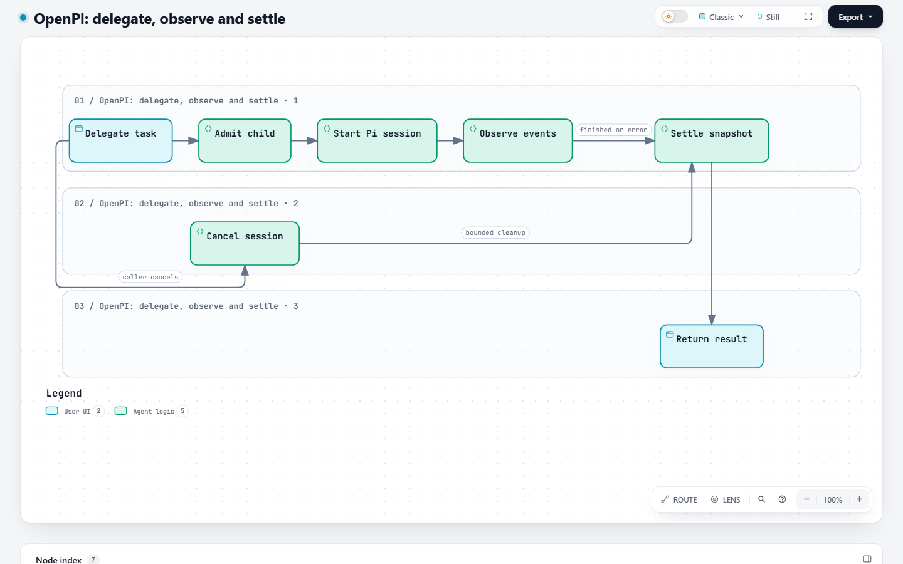 |  |

Screenshot capture is complete; no independent perceptual acceptance is claimed.

Source-backed authoring notes:

- [extensions/subagents/index.ts:1000–1012](https://github.com/openpi-dev/openpi/blob/677b4959108976b99fb63fb5029198b04aa51cb5/extensions/subagents/index.ts#L1000-L1012): The spawn tool accepts a bounded child request.
- [extensions/subagents/src/manager.ts:1–15](https://github.com/openpi-dev/openpi/blob/677b4959108976b99fb63fb5029198b04aa51cb5/extensions/subagents/src/manager.ts#L1-L15): The manager owns snapshots, the normalized event pump, settlement and scoped cancellation.
- [extensions/subagents/src/backends/pi.ts:893–910](https://github.com/openpi-dev/openpi/blob/677b4959108976b99fb63fb5029198b04aa51cb5/extensions/subagents/src/backends/pi.ts#L893-L910): Cancellation aborts the Pi session and waits for active prompt cleanup.

### openpi / architecture

[Identical Markdown](inputs/openpi-architecture.archify.md) · [Base native JSON](compiled/base/architecture/openpi.json) · [Candidate native JSON](compiled/head/architecture/openpi.json)

| Base | Candidate |
| --- | --- |
| No artifact: base standard rendering failed; see results.json. | 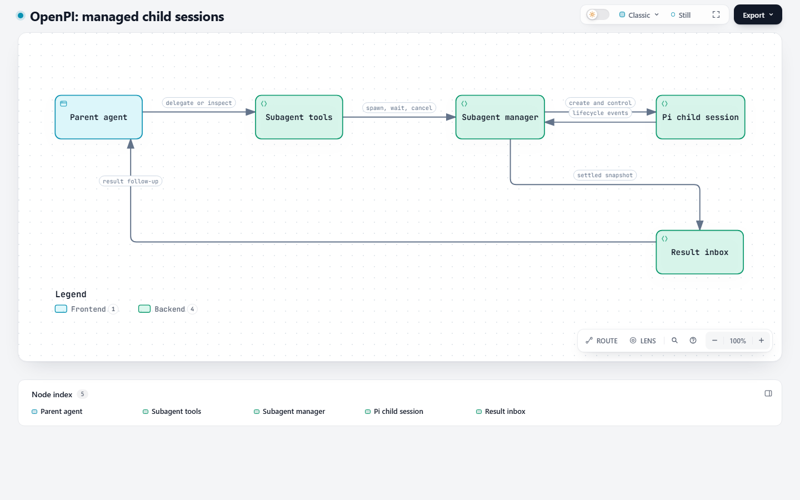 |

Screenshot capture is complete; no independent perceptual acceptance is claimed.

Source-backed authoring notes:

- [extensions/subagents/index.ts:2–15](https://github.com/openpi-dev/openpi/blob/677b4959108976b99fb63fb5029198b04aa51cb5/extensions/subagents/index.ts#L2-L15): The public tools spawn, wait, check and cancel child sessions.
- [extensions/subagents/src/manager.ts:1–15](https://github.com/openpi-dev/openpi/blob/677b4959108976b99fb63fb5029198b04aa51cb5/extensions/subagents/src/manager.ts#L1-L15): The manager creates a backend session and folds events into snapshots.
- [extensions/subagents/src/result-delivery.ts:16–38](https://github.com/openpi-dev/openpi/blob/677b4959108976b99fb63fb5029198b04aa51cb5/extensions/subagents/src/result-delivery.ts#L16-L38): The shared one-shot inbox delivers settled results to the parent without duplicate consumption.

### hive / workflow

[Identical Markdown](inputs/hive-workflow.archify.md) · [Base native JSON](compiled/base/workflow/hive.json) · [Candidate native JSON](compiled/head/workflow/hive.json)

| Base | Candidate |
| --- | --- |
| 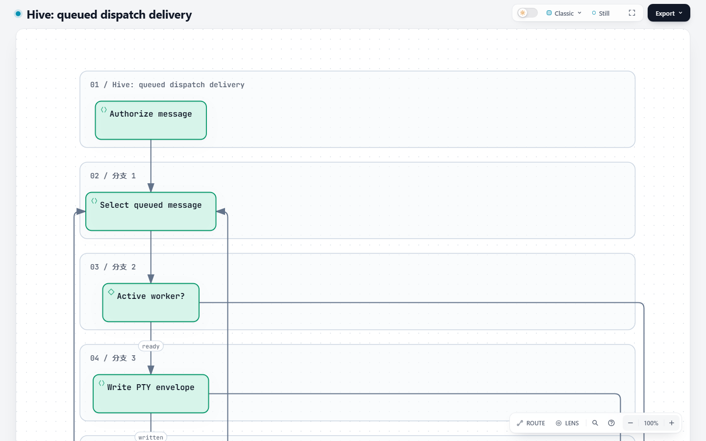 | 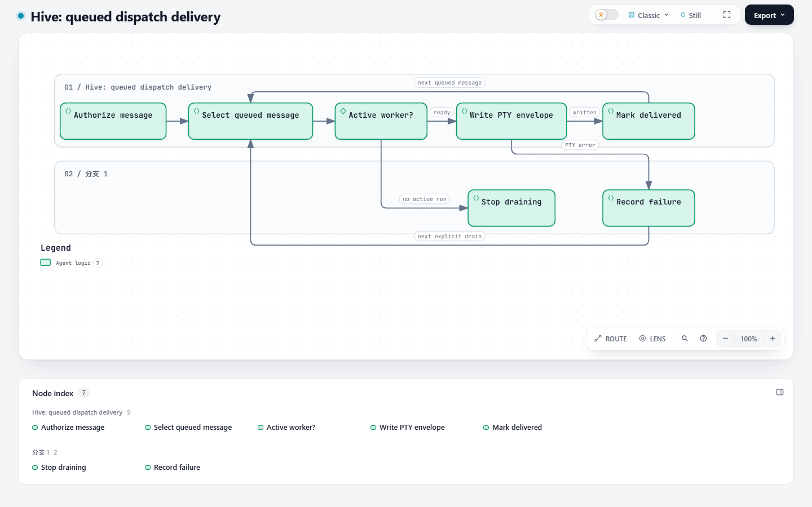 |

Author inspected both 900px and 1800px views. The old one-column stack needs scrolling; the candidate shows the seven nodes and separate next-message / explicit-retry returns in the initial viewport.

Source-backed authoring notes:

- [src/server/dispatch-message-operations.ts:70–95](https://github.com/tt-a1i/hive/blob/f8f1343da6595a232f0baba7f0ea5b5a58fe0e9c/src/server/dispatch-message-operations.ts#L70-L95): Authorization and insertion precede draining the recipient outbox.
- [src/server/dispatch-message-outbox.ts:38–73](https://github.com/tt-a1i/hive/blob/f8f1343da6595a232f0baba7f0ea5b5a58fe0e9c/src/server/dispatch-message-outbox.ts#L38-L73): A drain loops through queued messages, records writes and stops on a failed PTY until the next explicit drain/start.

### hive / architecture

[Identical Markdown](inputs/hive-architecture.archify.md) · [Base native JSON](compiled/base/architecture/hive.json) · [Candidate native JSON](compiled/head/architecture/hive.json)

| Base | Candidate |
| --- | --- |
| No artifact: base standard rendering failed; see results.json. | 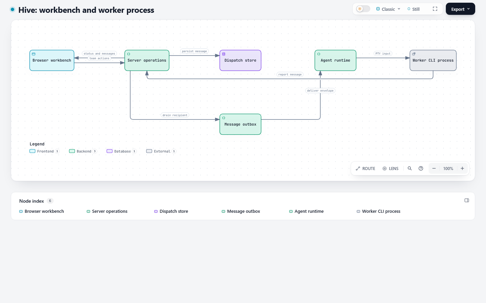 |

Screenshot capture is complete; no independent perceptual acceptance is claimed.

Source-backed authoring notes:

- [src/server/dispatch-message-operations.ts:70–95](https://github.com/tt-a1i/hive/blob/f8f1343da6595a232f0baba7f0ea5b5a58fe0e9c/src/server/dispatch-message-operations.ts#L70-L95): Server operations authorize and persist worker/orchestrator messages before draining.
- [src/server/agent-stdin-dispatcher.ts:194–207](https://github.com/tt-a1i/hive/blob/f8f1343da6595a232f0baba7f0ea5b5a58fe0e9c/src/server/agent-stdin-dispatcher.ts#L194-L207): Agent runtime delivery writes into an active worker input.
- [src/server/agent-manager.ts:125–157](https://github.com/tt-a1i/hive/blob/f8f1343da6595a232f0baba7f0ea5b5a58fe0e9c/src/server/agent-manager.ts#L125-L157): The manager starts the configured agent using a PTY process.
- [src/server/dispatch-message-operations.ts:99–128](https://github.com/tt-a1i/hive/blob/f8f1343da6595a232f0baba7f0ea5b5a58fe0e9c/src/server/dispatch-message-operations.ts#L99-L128): Server queries return current collaboration messages and required sequence state.

### mco / workflow

[Identical Markdown](inputs/mco-workflow.archify.md) · [Base native JSON](compiled/base/workflow/mco.json) · [Candidate native JSON](compiled/head/workflow/mco.json)

| Base | Candidate |
| --- | --- |
|  | 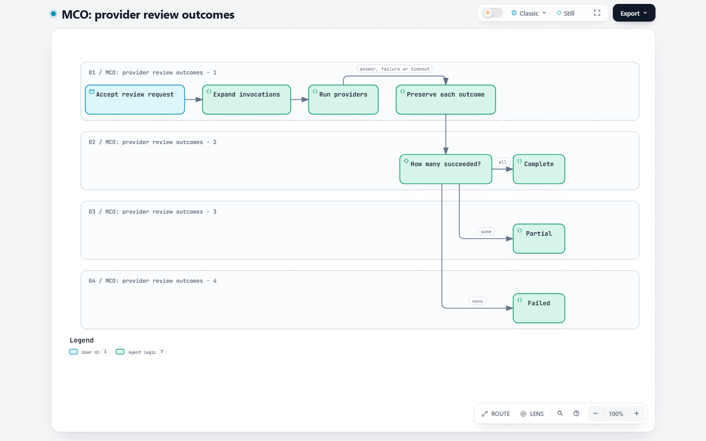 |

Screenshot capture is complete; no independent perceptual acceptance is claimed.

Source-backed authoring notes:

- [docs/contracts/invocation-runtime-v1.md:5–40](https://github.com/mco-org/mco/blob/3cfce130362dbcc2aedda6170d1a31e39cf67d3e/docs/contracts/invocation-runtime-v1.md#L5-L40): Provider declarations become separate invocations with explicit success, failed, timeout or cancelled status; aggregate statuses are complete, partial or failed.
- [runtime/invocation_runtime.py:498–576](https://github.com/mco-org/mco/blob/3cfce130362dbcc2aedda6170d1a31e39cf67d3e/runtime/invocation_runtime.py#L498-L576): The executor submits invocations and retains explicit exceptional outcomes.
- [runtime/invocation_runtime.py:600–611](https://github.com/mco-org/mco/blob/3cfce130362dbcc2aedda6170d1a31e39cf67d3e/runtime/invocation_runtime.py#L600-L611): The aggregate status derives from the number of successful outputs.

### mco / architecture

[Identical Markdown](inputs/mco-architecture.archify.md) · [Base native JSON](compiled/base/architecture/mco.json) · [Candidate native JSON](compiled/head/architecture/mco.json)

| Base | Candidate |
| --- | --- |
| No artifact: base standard rendering failed; see results.json. | 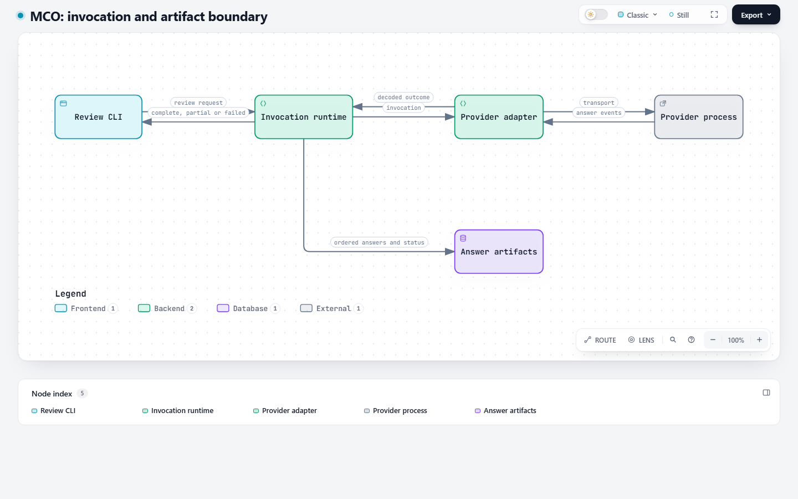 |

Author inspected the candidate-only view. Request and outcome directions are visibly separate, with artifacts below the main invocation path. Base produced no standard-profile artifact.

Source-backed authoring notes:

- [docs/contracts/invocation-runtime-v1.md:1–25](https://github.com/mco-org/mco/blob/3cfce130362dbcc2aedda6170d1a31e39cf67d3e/docs/contracts/invocation-runtime-v1.md#L1-L25): The invocation runtime owns execution and adapters transport and decode formal answer events.
- [runtime/invocation_runtime.py:498–541](https://github.com/mco-org/mco/blob/3cfce130362dbcc2aedda6170d1a31e39cf67d3e/runtime/invocation_runtime.py#L498-L541): The runtime schedules each selected invocation with its configured adapter.
- [runtime/invocation_runtime.py:600–623](https://github.com/mco-org/mco/blob/3cfce130362dbcc2aedda6170d1a31e39cf67d3e/runtime/invocation_runtime.py#L600-L623): The runtime aggregates outcomes and writes invocation artifacts.

### squad / workflow

[Identical Markdown](inputs/squad-workflow.archify.md) · [Base native JSON](compiled/base/workflow/squad.json) · [Candidate native JSON](compiled/head/workflow/squad.json)

| Base | Candidate |
| --- | --- |
| 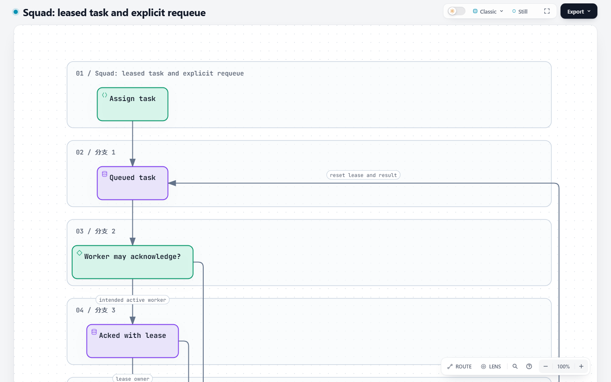 | 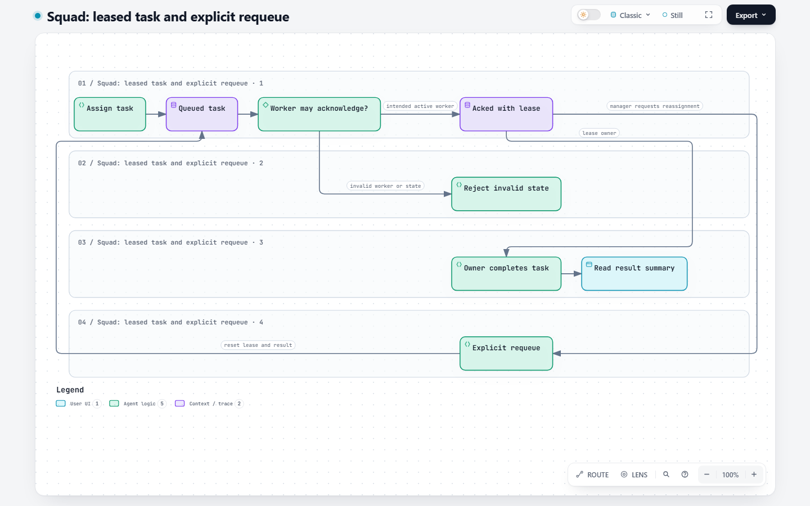 |

Author inspected both views. The candidate exposes all eight nodes and the invalid-worker branch. A long outer explicit-requeue route remains; passing checks do not make it an optimal layout.

Source-backed authoring notes:

- [src/store.rs:452–558](https://github.com/mco-org/squad/blob/8146bcc1c38c439aedaf3ff44548c830654c8621/src/store.rs#L452-L558): Task creation checks active creator/assignee and inserts the assignment message transactionally.
- [src/store.rs:617–683](https://github.com/mco-org/squad/blob/8146bcc1c38c439aedaf3ff44548c830654c8621/src/store.rs#L617-L683): Acknowledgement checks queued ownership; completion checks acked lease ownership.
- [src/store.rs:685–726](https://github.com/mco-org/squad/blob/8146bcc1c38c439aedaf3ff44548c830654c8621/src/store.rs#L685-L726): Explicit requeue resets lease, completion fields and optional assignee.

### squad / architecture

[Identical Markdown](inputs/squad-architecture.archify.md) · [Base native JSON](compiled/base/architecture/squad.json) · [Candidate native JSON](compiled/head/architecture/squad.json)

| Base | Candidate |
| --- | --- |
| No artifact: base standard rendering failed; see results.json. | 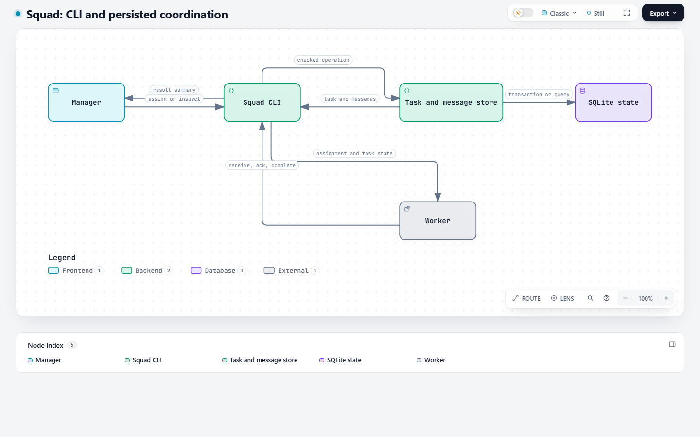 |

Screenshot capture is complete; no independent perceptual acceptance is claimed.

Source-backed authoring notes:

- [src/store.rs:339–375](https://github.com/mco-org/squad/blob/8146bcc1c38c439aedaf3ff44548c830654c8621/src/store.rs#L339-L375): Receiving messages reads and marks unread rows atomically.
- [src/store.rs:452–558](https://github.com/mco-org/squad/blob/8146bcc1c38c439aedaf3ff44548c830654c8621/src/store.rs#L452-L558): Task creation and assignment messaging share a transaction.
- [src/store.rs:617–683](https://github.com/mco-org/squad/blob/8146bcc1c38c439aedaf3ff44548c830654c8621/src/store.rs#L617-L683): Worker acknowledgement and completion update checked persisted task state.

### skillroster / workflow

[Identical Markdown](inputs/skillroster-workflow.archify.md) · [Base native JSON](compiled/base/workflow/skillroster.json) · [Candidate native JSON](compiled/head/workflow/skillroster.json)

| Base | Candidate |
| --- | --- |
| 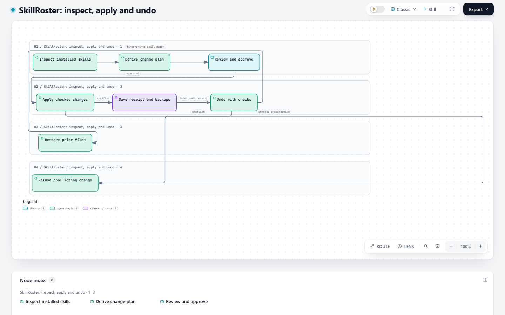 |  |

Author inspected the unchanged standard view and both showcase failures. Apply and undo failure routes share an ambiguous corridor and collide at their destination; this acyclic problem exists on both revisions and is outside the cyclic fix.

Source-backed authoring notes:

- [src/scan.rs:984–1002](https://github.com/tt-a1i/skillroster/blob/21d14c7cff25c66a016562e238e62d0538eb696f/src/scan.rs#L984-L1002): Scanning inspects installed skill state.
- [src/roster_plan.rs:703–724](https://github.com/tt-a1i/skillroster/blob/21d14c7cff25c66a016562e238e62d0538eb696f/src/roster_plan.rs#L703-L724): Roster planning derives operations from a snapshot.
- [src/main.rs:35–40](https://github.com/tt-a1i/skillroster/blob/21d14c7cff25c66a016562e238e62d0538eb696f/src/main.rs#L35-L40): Apply and undo start after human confirmation.
- [src/change.rs:637–650](https://github.com/tt-a1i/skillroster/blob/21d14c7cff25c66a016562e238e62d0538eb696f/src/change.rs#L637-L650): Prepared projections bind before and after fingerprints.
- [src/change.rs:680–705](https://github.com/tt-a1i/skillroster/blob/21d14c7cff25c66a016562e238e62d0538eb696f/src/change.rs#L680-L705): Apply obtains the shared write lock.
- [src/change.rs:929–972](https://github.com/tt-a1i/skillroster/blob/21d14c7cff25c66a016562e238e62d0538eb696f/src/change.rs#L929-L972): Undo obtains the same lock and checks the receipt before reversing operations.

### skillroster / architecture

[Identical Markdown](inputs/skillroster-architecture.archify.md) · [Base native JSON](compiled/base/architecture/skillroster.json) · [Candidate native JSON](compiled/head/architecture/skillroster.json)

| Base | Candidate |
| --- | --- |
| No artifact: base standard rendering failed; see results.json. | 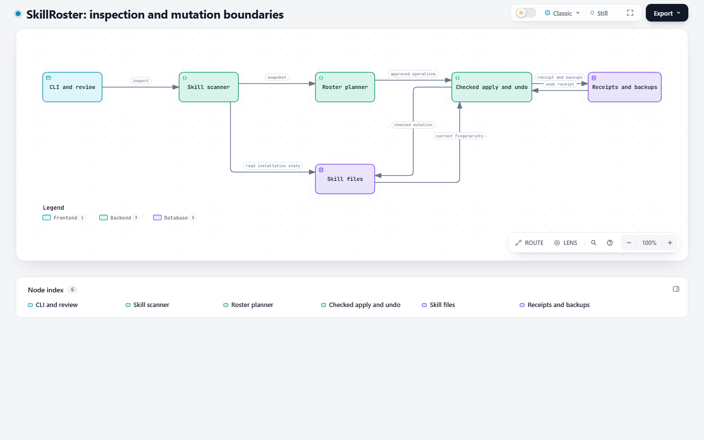 |

Screenshot capture is complete; no independent perceptual acceptance is claimed.

Source-backed authoring notes:

- [src/scan.rs:984–1002](https://github.com/tt-a1i/skillroster/blob/21d14c7cff25c66a016562e238e62d0538eb696f/src/scan.rs#L984-L1002): The scanner builds an installation snapshot.
- [src/roster_plan.rs:703–724](https://github.com/tt-a1i/skillroster/blob/21d14c7cff25c66a016562e238e62d0538eb696f/src/roster_plan.rs#L703-L724): The planner derives changes and backup locations.
- [src/change.rs:1–4](https://github.com/tt-a1i/skillroster/blob/21d14c7cff25c66a016562e238e62d0538eb696f/src/change.rs#L1-L4): Apply and undo are fail-closed, fingerprint-bound changes under one write lock.
- [src/change.rs:929–972](https://github.com/tt-a1i/skillroster/blob/21d14c7cff25c66a016562e238e62d0538eb696f/src/change.rs#L929-L972): Undo reads a prior change receipt before reversing filesystem effects.

## Fresh checks and reproducibility

Windows Developer Mode was enabled with user authorization. Ordinary file and directory symlink creation now succeeds. The 14 Node-only Explainer files passed **123/123**, with zero failures, cancellations or skips at the unchanged candidate revision. The two previous symlink-fixture failures pass without weakening tests. [Test log](explainer-tests.log) · [environment checks](environment-checks.json). Existing browser regression results remain under their original revision in the main report; screenshot capture is a separate check.

Materialize the two recorded revisions into separate clean checkouts and use Node 22. From the downloaded benchmark directory, replay any preserved Markdown input with each checkout's CLI:

```text
node <checkout>/archify/bin/archify.mjs deliver explainer inputs/hive-workflow.archify.md output.html --quality standard --writing off --json
```

The same-JSON check uses the existing helper without changing the input JSON:

```text
node <candidate>/.agents/skills/archify-tuning/scripts/replay.mjs --base <base>/archify --head <candidate>/archify --bench compiled/base --out replay-base-origin
node <candidate>/.agents/skills/archify-tuning/scripts/replay.mjs --base <base>/archify --head <candidate>/archify --bench compiled/head --out replay-head-origin
```

The helper prints a historical first-draft heading; this report uses it solely for fixed JSON replay, not as a first-draft Agent result. Input hashes, original standard native HTML where produced, paired screenshots, diagnostics and timing samples are retained in this evidence branch through review and the resulting release cycle. Full Explainer pages and raw receipts retain local path bindings and stay local; public JSON summaries have those paths redacted. The root SHA-256 manifest covers every published file. No hidden reasoning or private conversation is included. No production change or new speed claim is submitted by this evidence update.
